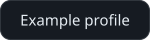
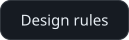
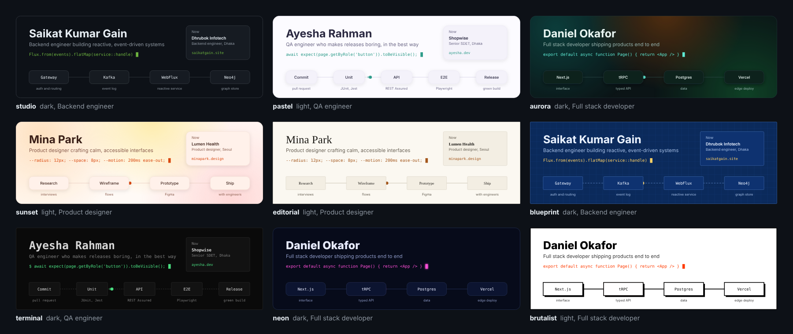
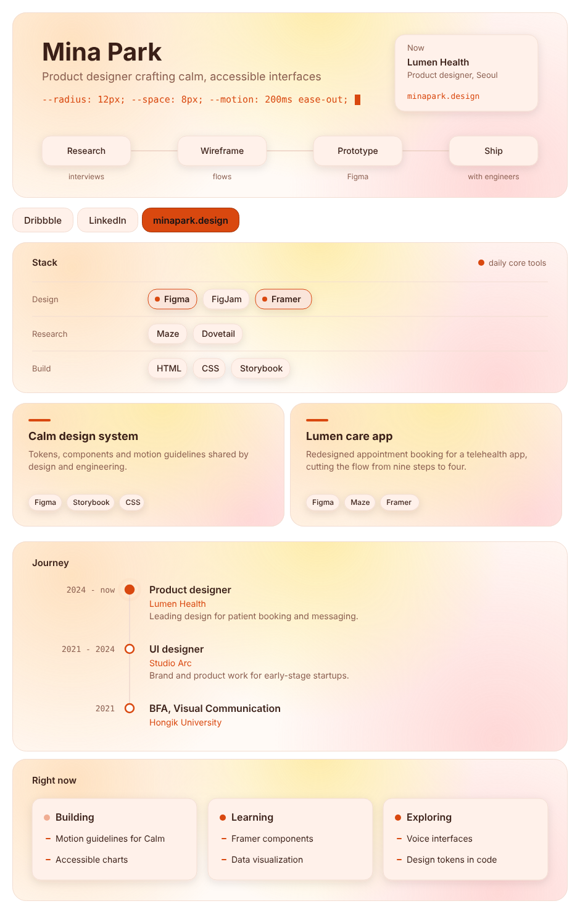
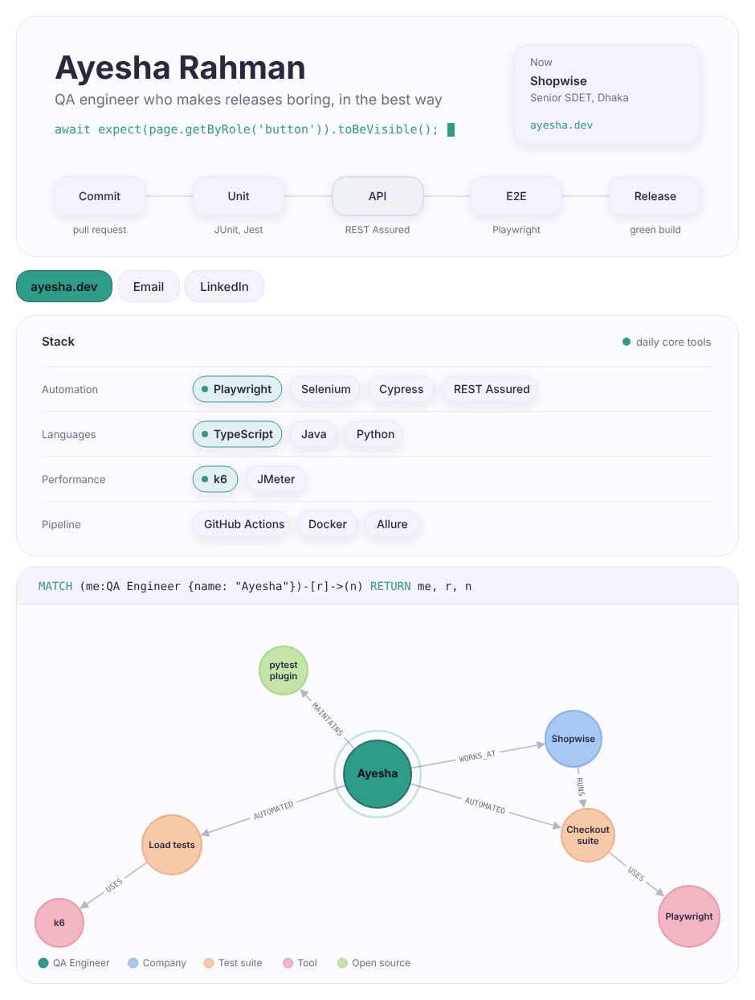

<!-- README.md -->

<picture>
  <source media="(prefers-color-scheme: dark)" srcset="assets/hero-dark.svg">
  <source media="(prefers-color-scheme: light)" srcset="assets/hero-light.svg">
  
</picture>

<p>
  <a href="https://github.com/SKgain/readme-studio/releases/latest"><picture><source media="(prefers-color-scheme: dark)" srcset="assets/btn-download-the-skill-dark.svg"><source media="(prefers-color-scheme: light)" srcset="assets/btn-download-the-skill-light.svg"></picture></a>
  <a href="readme-studio/assets/example-profile.json"><picture><source media="(prefers-color-scheme: dark)" srcset="assets/btn-example-profile-dark.svg"><source media="(prefers-color-scheme: light)" srcset="assets/btn-example-profile-light.svg"></picture></a>
  <a href="readme-studio/references/design-rules.md"><picture><source media="(prefers-color-scheme: dark)" srcset="assets/btn-design-rules-dark.svg"><source media="(prefers-color-scheme: light)" srcset="assets/btn-design-rules-light.svg"></picture></a>
</p>

Ask Claude for a beautiful GitHub README and this skill builds one that looks designed, not templated: custom animated panels in one visual system, in light and dark, built only from facts you give it. It works for **any profession**, comes in **nine themes**, and assembles **only the sections you have material for**. The README you are reading was made with it.

## Nine themes



| Theme | Feel |
|---|---|
| **studio** | GitHub-native panels; the safe default |
| **pastel** | soft pastel surfaces, big radii, gentle shadows |
| **aurora** | colour light drifting slowly behind frosted panels |
| **sunset** | warm peach and coral light |
| **editorial** | serif type on warm paper |
| **blueprint** | blue drafting paper with a grid |
| **terminal** | monospace and a shell prompt |
| **neon** | deep navy with a glowing accent |
| **brutalist** | thick borders and hard shadows |

## Any profession

Role presets give Claude a strong first draft for backend, frontend, full stack, QA, mobile, DevOps, security, embedded, game dev, data, ML, design, product, research and developer relations. Each preset is adapted to the tools you actually use, so two backend engineers on different stacks get different READMEs. See [professions.md](readme-studio/references/professions.md).

## Sections you choose

| Section | What it shows |
|---|---|
| **Hero** | Your name, tagline, an optional line of code, and an event travelling through *your* workflow, lighting each stage as it arrives |
| **Buttons** | Your links, one primary in the accent colour |
| **Stack panel** | Your tools by layer, with your daily core tools highlighted |
| **Project list or cards** | Projects as text, or as clickable cards two per row |
| **Timeline** | Jobs and studies on a line that draws itself |
| **Focus board** | What you are building, learning and exploring now |
| **Graph** | A Neo4j Browser-style graph of how your work connects |
| **Publications** | Papers and venues |

Everything is plain SVG files committed to your repo. No GitHub Actions, no third-party stat cards, nothing that can break later.

## Examples

A product designer in **sunset**, with project cards, a timeline and a focus board, and no graph:



<details>
<summary>A backend engineer in studio, with a graph and publications</summary>


</details>

<details>
<summary>A QA engineer in pastel</summary>



</details>

## Install

1. Download `readme-studio.zip` from the [latest release](https://github.com/SKgain/readme-studio/releases/latest).
2. In Claude, open **Settings > Capabilities** and make sure **Code execution and file creation** is on.
3. In the **Skills** section, click **Upload skill** and choose the ZIP.

Custom skills are available on Pro, Max and Team plans. On Enterprise, an owner first enables skills in Admin settings.

## Use

Just ask:

> Make me an attractive, animated GitHub profile README.

Claude collects your links, projects, stack and anything worth putting in the graph, asking once for whatever is missing. It generates the panels, screenshots them in both themes, fixes anything that collides, and hands you a ZIP with upload steps.

It works for **project READMEs** too: the project's architecture becomes the hero pipeline.

## How it works

<picture>
  <source media="(prefers-color-scheme: dark)" srcset="assets/graph-dark.svg">
  <source media="(prefers-color-scheme: light)" srcset="assets/graph-light.svg">
  
</picture>

- **`profile.json`** holds every fact. The [schema](readme-studio/references/schema.md) explains each field.
- **`scripts/generate.py`** turns it into the SVGs and the README. It needs only Python 3, no packages.
- **`scripts/preview.py`** screenshots both themes mid-animation, so Claude can check the result before you see it. It needs Playwright and Chrome, and skips cleanly without them.

You can also run it yourself:

```bash
python3 readme-studio/scripts/generate.py my-profile.json out/ --theme aurora
python3 readme-studio/scripts/generate.py --themes   # list all themes
```

## Design principles

- One accent colour, one idea per panel, one shared frame.
- Motion that means something: the event flows through your real system, and the graph grows out of you.
- Every animation has a reduced-motion fallback, and every image has full alt text.
- No emoji icons, no rainbow badge walls, and never an invented metric or link.

Full rules, including what GitHub's sanitizer allows: [design-rules.md](readme-studio/references/design-rules.md).

## Contributing

Ideas and pull requests are welcome, especially new panel types and better graph layouts. Please keep every panel self-contained SVG with a reduced-motion fallback.

## License

[MIT](LICENSE). Made by [Saikat Kumar Gain](https://github.com/SKgain).
