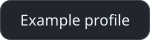
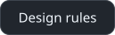
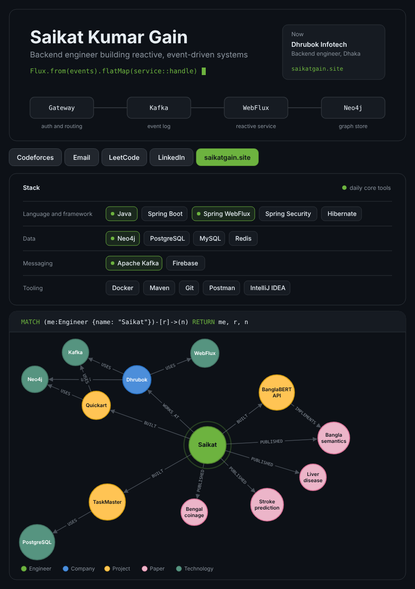
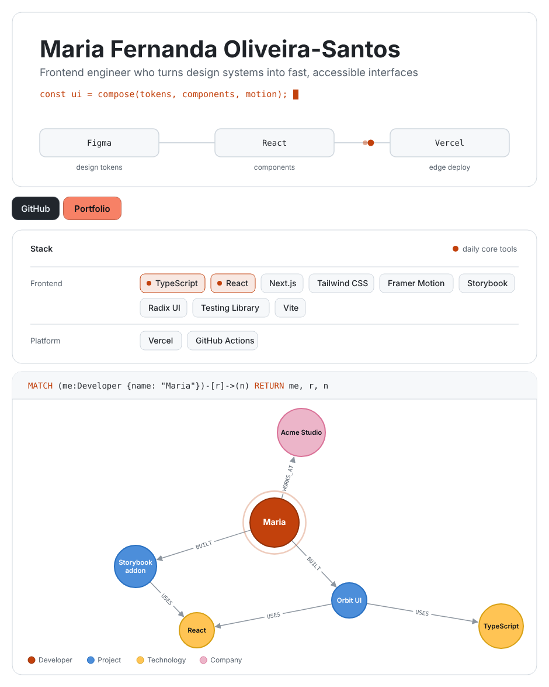

<!-- README.md -->

<picture>
  <source media="(prefers-color-scheme: dark)" srcset="assets/hero-dark.svg">
  <source media="(prefers-color-scheme: light)" srcset="assets/hero-light.svg">
  
</picture>

<p>
  <a href="https://github.com/SKgain/readme-studio/releases/latest"></a>
  <a href="readme-studio/assets/example-profile.json"></a>
  <a href="readme-studio/references/design-rules.md"></a>
</p>

Ask Claude for a beautiful GitHub README and this skill builds one that looks designed, not templated: custom animated panels in one visual system, in light and dark, built only from facts you give it. The README you are reading was made with it.

## What you get

| Panel | What it shows |
|---|---|
| **Hero** | Your name, tagline, a line of code with a blinking cursor, and an event travelling through *your* architecture, lighting up each stage as it arrives |
| **Buttons** | Your links, with one primary action in your accent colour |
| **Stack panel** | Your tools grouped by layer, with your daily core tools highlighted |
| **Graph** | A Neo4j Browser-style graph that builds itself outward from you: what you built, where you work, what you published, and how it all connects |

Everything is plain SVG files committed to your repo. No GitHub Actions, no third-party stat cards, nothing that can break later.

## Examples

A backend engineer, dark theme:



<details>
<summary>A frontend engineer, light theme</summary>



</details>

## Install

1. Download `readme-studio.zip` from the [latest release](https://github.com/SKgain/readme-studio/releases/latest).
2. In Claude, open **Settings > Capabilities** and make sure **Code execution and file creation** is on.
3. In the **Skills** section, click **Upload skill** and choose the ZIP.

Custom skills are available on Pro, Max and Team plans. On Enterprise, an owner first enables skills in Admin settings.

## Use

Just ask:

> Make me an attractive, animated GitHub profile README.

Claude collects your links, projects, stack and anything worth putting in the graph, asking once for whatever is missing. It generates the panels, screenshots them in both themes, fixes anything that collides, and hands you a ZIP with upload steps.

It works for **project READMEs** too: the project's architecture becomes the hero pipeline.

## How it works

<picture>
  <source media="(prefers-color-scheme: dark)" srcset="assets/graph-dark.svg">
  <source media="(prefers-color-scheme: light)" srcset="assets/graph-light.svg">
  
</picture>

- **`profile.json`** holds every fact. The [schema](readme-studio/references/schema.md) explains each field.
- **`scripts/generate.py`** turns it into the SVGs and the README. It needs only Python 3, no packages.
- **`scripts/preview.py`** screenshots both themes mid-animation, so Claude can check the result before you see it. It needs Playwright and Chrome, and skips cleanly without them.

You can also run it yourself:

```bash
python3 readme-studio/scripts/generate.py my-profile.json out/
```

## Design principles

- One accent colour, one idea per panel, one shared frame.
- Motion that means something: the event flows through your real system, and the graph grows out of you.
- Every animation has a reduced-motion fallback, and every image has full alt text.
- No emoji icons, no rainbow badge walls, and never an invented metric or link.

Full rules, including what GitHub's sanitizer allows: [design-rules.md](readme-studio/references/design-rules.md).

## Contributing

Ideas and pull requests are welcome, especially new panel types and better graph layouts. Please keep every panel self-contained SVG with a reduced-motion fallback.

## License

[MIT](LICENSE). Made by [Saikat Kumar Gain](https://github.com/SKgain).
